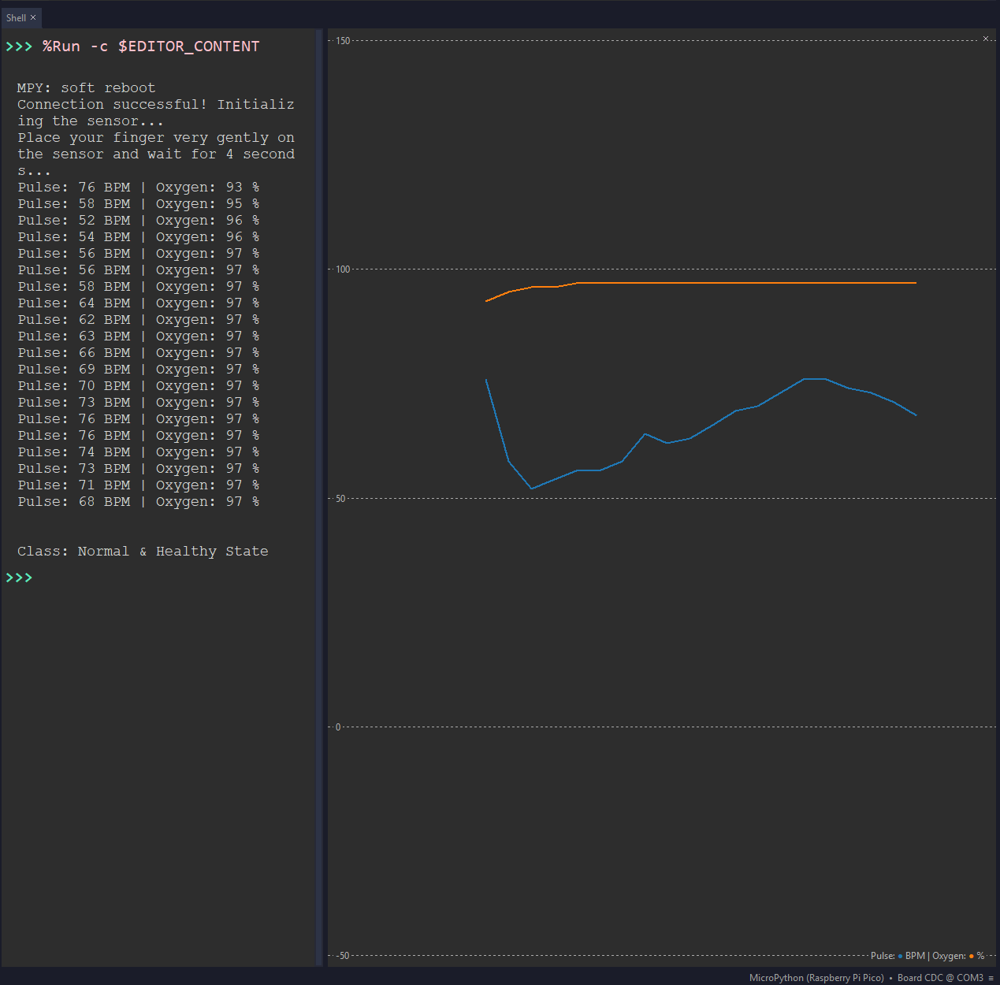

# 🩺 Smart Biomedical Pulse Oximeter (Raspberry Pi Pico W & MAX30102)

An embedded biomedical signal acquisition and classification system built with **MicroPython** on the **Raspberry Pi Pico W**. This project captures raw photoplethysmography (PPG) optical signals using the **MAX30102** sensor, applies digital signal filtering to eliminate settling noise and motion artifacts, and utilizes a **Multi-Label Decision Tree Classifier** to evaluate patient vital signs in real time.

---

## 📊 Live Signal Output & Classification Result

*Figure 1: Real-time Thonny Plotter & Shell output demonstrating signal stabilization across 20 readings, converging at a stable **97% SpO2** and **68 BPM** (`Class: Normal & Healthy State`).*

---

## 🧠 System Architecture & Signal Processing Pipeline

The software architecture follows a 4-stage biomedical Digital Signal Processing (DSP) pipeline:

1. **Optical Signal Acquisition (`I2C` @ 400 kHz):**
   * Continuously samples raw Red and Infrared (`IR`) light absorption data from the `MAX30102` FIFO storage buffer.
   * Implements an automatic finger-presence detection threshold (`IR < 10000`) to pause analysis when the sensor is uncovered.
2. **Peak Detection & Physiological Validation (`hrcalc.py`):**
   * Evaluates 100-sample windows (at a `25 Hz` / `0.04s` sampling interval) to detect systolic peaks in the IR waveform and compute the AC/DC ratio for blood oxygen saturation ($SpO_2$).
   * Rejects physiologically impossible noise outside the `[40 - 180 BPM]` heart rate range and `[50% - 100%]` $SpO_2$ range.
3. **Sliding-Window Moving Average Filter (`oximeter.py`):**
   * Maintains a dynamic sliding window of the latest **12 valid readings**, automatically discarding the initial 8 settling readings via `.pop(0)` to eliminate sensor warm-up drift.
4. **Motion Artifact Detection & Multi-Label Decision Tree Classifier:**
   * Computes signal dispersion (`spread = max(final_hr) - min(final_hr)`) across the smoothed window to verify physical stability before issuing a medical classification.
   * Evaluates $SpO_2$ and Heart Rate in parallel (`if` / `if-elif`) to support simultaneous multi-condition alerts:

| Condition / Threshold | Classification Output | Clinical / Physiological Meaning |
| :--- | :--- | :--- |
| `spread > 15 BPM` | `Unstable Reading (Motion Artifact)` | High dispersion due to finger movement; halts diagnosis. |
| `smoothed_spo2 < 92%` | `Low Oxygen Alert` | Potential hypoxemia; triggered independently of HR. |
| `smoothed_hr > 100 BPM` | `High Heart Rate (Active / Stressed)` | Tachycardia range (physical exertion or stress). |
| `50 <= smoothed_hr <= 60 BPM` | `Relaxed / Athletic State` | Calm resting state or high cardiovascular efficiency. |
| `smoothed_hr < 50 BPM` | `Low Heart Rate` | Clinical bradycardia alert threshold. |
| `60 < HR <= 100` & `SpO2 >= 92%` | `Normal & Healthy State` | Optimal resting vital signs. |

---

## 🔌 Hardware Pinout (I2C0 Interface)

| MAX30102 Pin | Raspberry Pi Pico W Pin | Function |
| :--- | :--- | :--- |
| **VIN** | `3V3 (OUT)` (Pin 36) | 3.3V Power Supply |
| **GND** | `GND` (Pin 3 / Pin 38) | Common Ground |
| **SDA** | `GP0` (Pin 1) | I2C0 Data Line |
| **SCL** | `GP1` (Pin 2) | I2C0 Clock Line |

---

## 📂 Repository File Structure

* `oximeter.py` — Main application script: I2C initialization, 12-sample moving average filter, dispersion calculation, and Decision Tree classification logic.
* `hrcalc.py` — Mathematical algorithm for IR peak detection, BPM interval calculation, and standard MAX30102 $SpO_2$ calibration curve (`-45.060 * R² + 30.354 * R + 94.845`).
* `scanner.py` — Diagnostic utility to scan the I2C bus and verify hardware wiring and sensor address (`0x57`).
* `lib/` — Driver package containing the `MAX30102` MicroPython register configuration library.
* `result_graph1.png.png` — Recorded test run showing the serial readings and real-time plotter waveform.

---

## 🚀 How to Run

1. Flash **MicroPython** firmware onto the Raspberry Pi Pico W and open the project in **Thonny IDE**.
2. Upload the `lib/` folder, `hrcalc.py`, `scanner.py`, and `oximeter.py` to the root directory of the Pico.
3. Run `scanner.py` first to verify the `I2C` physical connection.
4. Place your index finger gently on the `MAX30102` optical window and run `oximeter.py` to view real-time vital signs, waveform plotting, and the final diagnostic classification after 20 valid samples.
